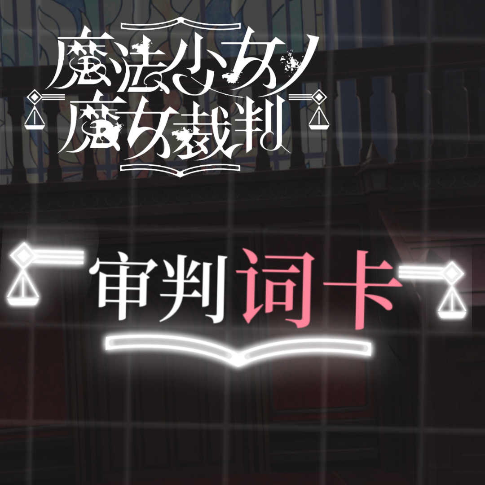

# DialoCard 审判词卡

基于《魔法少女的魔女裁判》审判过程 UI 二改的 AstrBot 插件。将 LLM 回复渲染为精美词卡图片，关键词粉色高亮。

## 特性

- **多角色差分立绘**：角色来自 PSD 差分图层（眼神 / 嘴型 / 脸颊 / 手臂 / 特效），atlas 图集运行时实时合成，切换角色零成本
- **情绪差分**：default / smile / angry / cry / afraid / surprise / confused / flushed / embarrass / wronged / paint，由 LLM 按语境自选
- **三版式随机构图**：左文 / 右文 / 无立绘，背景与文字同角度倾斜
- **Keyword 高亮**：LLM 自动选择关键词粉色高亮，字号放大 1.2 倍
- **情绪组合内置兜底**：emotions.json 被误删 / 重置时渲染自动回退代码内置组合，永不走样
- **WebUI 控制台**：仪表盘 → 插件 → 词卡 → Pages，可视化编辑情绪差分图层组合、全局构图，试渲染走真实发卡管线
- **资产自动下载**：首次启动自动下载全量角色包与完整字体（GitHub Releases），内置诺亚开箱即用
- **优雅降级**：atlas 图集 → 预烘焙角色层 → 旧版整卡图 → 纯文字，逐级兜底

## 安装

从 AstrBot 插件市场搜索「词卡」安装，或手动安装到 `data/plugins/`。安装后即可用（内置诺亚），首次启动自动下载其余角色与完整字体。

## 配置

| 项 | 默认 | 说明 |
|---|---|---|
| `character` | `Noah` | 当前角色（asset/characters/ 下的目录名） |
| `asset_url` | Releases 直链 | 全量角色包 zip（13 角色）；上架包仅内置诺亚，首次启动自动下载全部角色 |
| `font_url` | Releases 直链 | 完整版思源宋体（含「欸」等 GB2312 外口语字）；上架包只带子集，首次启动自动下载。渲染字体写死完整版优先、子集兜底 |

## WebUI 控制台

仪表盘 → 插件 → 词卡 → Pages → console：

- **情绪差分编辑**：勾选每个情绪开启 / 关闭 / 叠加的图层，实时预览，保存后热生效（自动留档 .bak）
- **全局构图**：立绘角度、缩放、位移
- **试渲染**：走真实发卡管线出图，所见即所得

## 开发工具

`tools/` 下为 PSD 图集导出与字体子集化脚本（`tools/subset_font.py` 可重新生成 GB2312 子集，已补入「欸诶」等口语字）。

## 声明

本插件为《魔法少女的魔女裁判》审判过程 UI 同人二改，角色素材版权归原作者所有，仅作学习交流用途，与官方无关。
